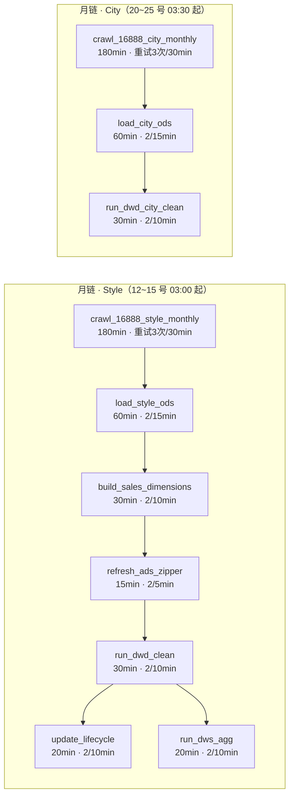
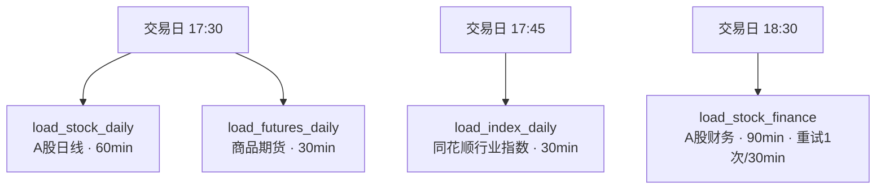
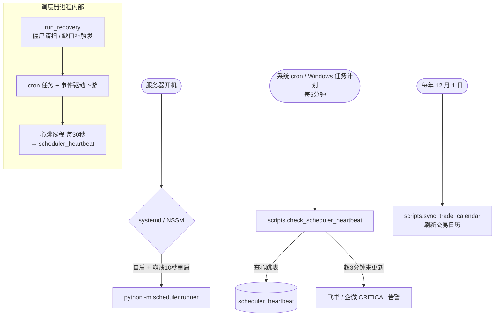

# CarApp 调度器上手指南

> 一份让你 5 分钟看懂"调度器什么时候跑、跑什么、怎么让它自动跑"的说明。
> 字段级细节见 [scheduler_tasks.md](./scheduler_tasks.md)，权威配置见 [scheduler/task_config.py](../scheduler/task_config.py)。

---

## 1. 它是什么

CarApp 调度器是一个基于 **APScheduler 3.x** 的常驻进程：

- 入口：`python -m scheduler.runner`
- 类型：`BlockingScheduler`（阻塞主线程常驻）
- 时区：`Asia/Shanghai`
- 任务持久化：业务库 `dw_auto_stock` 中的 `apscheduler_jobs` 表
- 任务清单：14 个（6 个 cron 根任务 + 8 个事件触发下游）
- 配置唯一来源：[scheduler/task_config.py](../scheduler/task_config.py)

每个任务都被 `@task` 装饰器包裹，**业务代码跑在独立 spawn 子进程里**，所以爬虫/Playwright 崩了不会拖垮调度器主进程。

---

## 2. 架构总览

```mermaid
flowchart TB
    subgraph 调度器主进程["scheduler.runner（常驻）"]
        APS[APScheduler<br/>BlockingScheduler]
        DEC[@task 装饰器<br/>重试/超时/日志/守卫]
        HB[心跳线程<br/>每 30 秒]
        REC[启动恢复<br/>僵尸清扫 + 缺口补触发]
    end

    SUB[(业务库 MySQL<br/>dw_auto_stock)]
    LOG[scheduler_run_log]
    HBT[scheduler_heartbeat]
    APSJOB[apscheduler_jobs]
    CAL[dim_trade_calendar]
    SUB --> LOG
    SUB --> HBT
    SUB --> APSJOB
    SUB --> CAL

    CRON([系统时钟 / cron 触发]) --> APS
    APS --> DEC
    DEC -->|spawn 子进程| JOB[业务脚本<br/>爬虫 / ETL / 入库]
    JOB -->|成功| DOWN[触发下游任务]
    JOB -->|失败| RETRY[按间隔重试]
    RETRY -->|耗尽| ALERT[飞书/企微告警]
    JOB -->|写运行日志| LOG
    HB --> HBT
    REC --> LOG
    REC --> DOWN

    EXT([外部 cron 每 5 分钟<br/>check_scheduler_heartbeat]) --> HBT
    EXT -->|心跳超时| ALERT
```

---

## 3. 任务什么时候跑

### 3.1 月链（每月发布窗口内每日探测）

车型月销量（style）每月 **12~15 号 03:00** 探测；城市车型月销量（city）每月 **20~25 号 03:30** 探测。站点未发布数据时任务抛 `SkipTask`，次日再探；已发布则事件驱动整条链。



### 3.2 日链（交易日 17:30 起并行）

日链任务都带 `trade_calendar="SSE"`，执行前查 `dim_trade_calendar`，非交易日直接 `skipped`（不告警、不重试）。



> ⚠️ 已知隐患：`load_futures_daily` 是商品期货数据，但目前也用 SSE（A股）交易日历。A股休市而商品开市的日子（如部分黄金周）会被误跳过，需留意。

### 3.3 规则速查表

| task_id | cron（Asia/Shanghai） | 超时 | 重试 / 间隔 | 交易日守卫 | business_key |
|---|---|---|---|---|---|
| `crawl_16888_style_monthly` | 每月 12–15 号 03:00 | 180min | 3 / 30min | — | last_month |
| `load_style_ods` | 事件触发 | 60min | 2 / 15min | — | 继承 |
| `build_sales_dimensions` | 事件触发 | 30min | 2 / 10min | — | 继承 |
| `refresh_ads_zipper` | 事件触发 | 15min | 2 / 5min | — | 继承 |
| `run_dwd_clean` | 事件触发 | 30min | 2 / 10min | — | 继承 |
| `update_lifecycle` | 事件触发 | 20min | 2 / 10min | — | 继承 |
| `run_dws_agg` | 事件触发 | 20min | 2 / 10min | — | 继承 |
| `crawl_16888_city_monthly` | 每月 20–25 号 03:30 | 180min | 3 / 30min | — | last_month |
| `load_city_ods` | 事件触发 | 60min | 2 / 15min | — | 继承 |
| `run_dwd_city_clean` | 事件触发 | 30min | 2 / 10min | — | 继承 |
| `load_stock_daily` | 周一至五 17:30 | 60min | 2 / 10min | SSE | today |
| `load_futures_daily` | 周一至五 17:30 | 30min | 2 / 10min | SSE | today |
| `load_index_daily` | 周一至五 17:45 | 30min | 2 / 10min | SSE | today |
| `load_stock_finance` | 周一至五 18:30 | 90min | 1 / 30min | SSE | today |

**全局缺省**（[runner.py](../scheduler/runner.py)）：

- `misfire_grace_time = 24h`（错过 24 小时内仍补跑）
- `coalesce = True`（多次积压只跑一次）
- `max_instances = 1`（同一任务绝不并发）

### 3.4 重试 / 超时 / 跳过语义

- **失败重试**：由 `@task` 捕获异常，通过 APScheduler `date` trigger 在 `now + retry_interval_minutes` 重跑；重试 job_id 形如 `retry::<task_id>::<run_id>::<n>`；耗尽后状态置 `failed` 并发 **ERROR** 告警。
- **超时强杀**：子进程由 `multiprocessing spawn` 启动，超时调用 `taskkill /T /F /PID`（Windows）或 `killpg(SIGKILL)`（Linux），连同 Playwright/Chromium 孙进程一起收掉。
- **SkipTask（不重试、不告警）**：非交易日、月链站点未发布、维度未就绪等"正常跳过"场景。
- **触发类型**：`cron` / `manual` / `dependency` / `retry`，写入 `scheduler_run_log.trigger_type`。

### 3.5 启动恢复与心跳

调度器每次启动会执行 `run_recovery`：

1. 把所有残留 `running` / `retrying` 记录置为 `killed`；
2. UPSERT `scheduler_heartbeat` 单行（id=1）；
3. 扫描近 24 小时内成功但下游缺记录的任务，按 `parent_run_id` **幂等补触发**下游。

启动后心跳线程每 **30 秒** 更新一次 `scheduler_heartbeat.last_heartbeat`。

---

## 4. 怎么让它自动跑起来

### 4.1 一次性前置准备

```bash
# 1. 安装依赖
pip install -r requirements.txt
playwright install chromium          # 月链爬虫需要

# 2. 配置环境变量
cp .env.example .env
# 编辑 .env，至少填好 DB_HOST/DB_USER/DB_PASSWORD/DB_NAME
# ALERT_WEBHOOK_URL 建议填上（飞书/企微机器人），留空则只写日志

# 3. 初始化数据库（会按 system→ods→dim→dwd→dws→ads→scheduler 顺序建表）
python scripts/init_database.py

# 4. 灌入 A 股交易日历（日链守卫依赖此表）
python -m scripts.sync_trade_calendar
```

部署前建议先做一次静态校验：

```bash
python scripts/dry_run_scheduler.py
```

### 4.2 手动前台启动（调试用）

```bash
python -m scheduler.runner
```

看到 `注册 cron 任务: ...` 与 `调度器启动（host=...）` 即表示成功。`Ctrl+C` 停止。

### 4.3 Linux：systemd 开机自启（推荐生产方式）

仓库已提供单元文件 [deploy/scheduler.service](../deploy/scheduler.service)：

```ini
[Unit]
Description=CarApp Scheduler (APScheduler)
After=network.target mysql.service
Wants=network-online.target

[Service]
Type=simple
User=carapp
Group=carapp
WorkingDirectory=/opt/carapp
Environment=APP_ENV=prod
EnvironmentFile=-/opt/carapp/.env
ExecStart=/opt/carapp/.venv/bin/python -m scheduler.runner
Restart=always
RestartSec=10
StandardOutput=append:/var/log/carapp/scheduler.out.log
StandardError=append:/var/log/carapp/scheduler.err.log

[Install]
WantedBy=multi-user.target
```

部署命令（在服务器上，假设项目在 `/opt/carapp`）：

```bash
sudo mkdir -p /var/log/carapp
sudo cp deploy/scheduler.service /etc/systemd/system/scheduler.service
sudo systemctl daemon-reload
sudo systemctl enable --now scheduler

# 查看状态 / 实时日志
systemctl status scheduler
journalctl -u scheduler -f
```

`Restart=always` + `RestartSec=10` 表示进程崩溃后 10 秒自动拉起。

### 4.4 Windows：NSSM 服务自启

仓库已提供安装脚本 [deploy/install_scheduler_nssm.ps1](../deploy/install_scheduler_nssm.ps1)，要求：

- 预先下载 [NSSM](https://nssm.cc/) 并把 `nssm.exe` 加入 PATH；
- 以**管理员身份**打开 PowerShell。

```powershell
# -ProjectRoot  项目根目录
# -Python       python.exe 的绝对路径（建议用虚拟环境里的）
.\deploy\install_scheduler_nssm.ps1 `
    -ProjectRoot C:\Path\To\CarApp `
    -Python     C:\Path\To\.venv\Scripts\python.exe
```

脚本内部会把 `python -m scheduler.runner` 注册为名为 `CarAppScheduler` 的 Windows 服务，设为 `SERVICE_AUTO_START`，并配置崩溃 10 秒重启。日志默认写到 `<ProjectRoot>\logs\scheduler.{out,err}.log`。

常用维护命令：

```powershell
nssm status   CarAppScheduler
nssm restart  CarAppScheduler
nssm remove   CarAppScheduler confirm
```

### 4.5 外部脚本：心跳探活（建议都配）

[scheduler.runner](../scheduler/runner.py) 自身只负责写心跳，**不会主动报警自己挂了**。需要用系统级定时任务每 **5 分钟**跑一次 [scripts/check_scheduler_heartbeat.py](../scripts/check_scheduler_heartbeat.py)：

- 心跳在 **3 分钟**内未更新 → 通过 webhook 发 **CRITICAL** 告警；
- 心跳表为空（从未启动）→ 同样 CRITICAL。

**Linux（crontab -e）：**

```cron
*/5 * * * * cd /opt/carapp && /opt/carapp/.venv/bin/python -m scripts.check_scheduler_heartbeat >> /var/log/carapp/heartbeat.log 2>&1
```

**Windows（任务计划程序）：**

1. 新建任务 → 触发器：每日，重复任务间隔 **5 分钟**，持续时间 24 小时；
2. 操作：启动程序
   - 程序：`C:\Path\To\.venv\Scripts\python.exe`
   - 参数：`-m scripts.check_scheduler_heartbeat`
   - 起始于：`C:\Path\To\CarApp`
3. 勾选"不管用户是否登录都要运行"。

另外，交易日历每年需更新一次，可在服务器加一行年度 cron：

```cron
0 6 1 12 * cd /opt/carapp && /opt/carapp/.venv/bin/python -m scripts.sync_trade_calendar
```

### 4.6 自动化拓扑



---

## 5. 排障速查

| 现象 | 排查方向 |
|---|---|
| 任务一直卡在 `running` | 调度器被强杀（-9 / 直接关机）会留下僵尸记录；下次启动 `run_recovery` 会自动置为 `killed`。手动重启调度器即可。 |
| 任务状态是 `skipped` | 正常现象：非交易日、月链站点未发布、或上游维度未就绪。看日志确认具体原因。 |
| 收到心跳 CRITICAL 告警 | 先 `systemctl status scheduler` / `nssm status CarAppScheduler`；再看 `scheduler.err.log`。进程没挂但心跳停了，多半是数据库连接断了。 |
| 任务 `failed` 且没在重试 | 重试次数已耗尽，或抛的是不可重试异常；看运行日志定位堆栈。 |
| 月链到窗口结束还没抓到数据 | 站点发布延迟，下一个窗口日（12→13→14→15）会继续探测；若 15 号后仍无数据，人工检查站点结构是否变化。 |
| 商品期货某天没数据 | 检查是否 A 股休市而商品开市——当前 `load_futures_daily` 用的是 SSE 日历，会误跳过。 |

---

## 6. 参考文件

- 任务配置（权威）：[scheduler/task_config.py](../scheduler/task_config.py)
- 调度器入口：[scheduler/runner.py](../scheduler/runner.py)
- 运行时（重试/超时/恢复/心跳）：[scheduler/runtime.py](../scheduler/runtime.py)
- 告警通道：[scheduler/alert.py](../scheduler/alert.py)
- 任务字段级文档：[docs/scheduler_tasks.md](./scheduler_tasks.md)
- Linux 服务单元：[deploy/scheduler.service](../deploy/scheduler.service)
- Windows NSSM 脚本：[deploy/install_scheduler_nssm.ps1](../deploy/install_scheduler_nssm.ps1)
- 心跳探活脚本：[scripts/check_scheduler_heartbeat.py](../scripts/check_scheduler_heartbeat.py)
- 交易日历同步：[scripts/sync_trade_calendar.py](../scripts/sync_trade_calendar.py)
- 数据库初始化：[scripts/init_database.py](../scripts/init_database.py)
- 部署前 dry-run：[scripts/dry_run_scheduler.py](../scripts/dry_run_scheduler.py)
- 环境变量样例：[.env.example](../.env.example)
