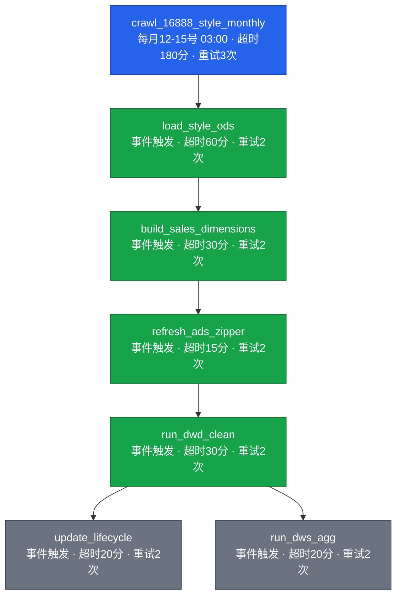
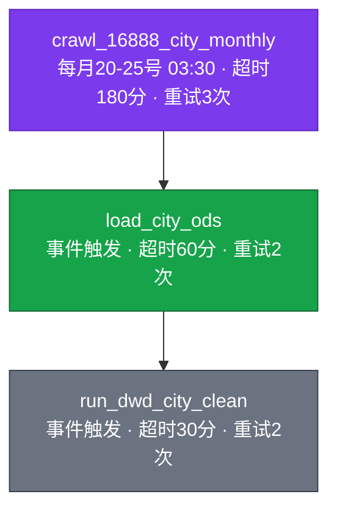
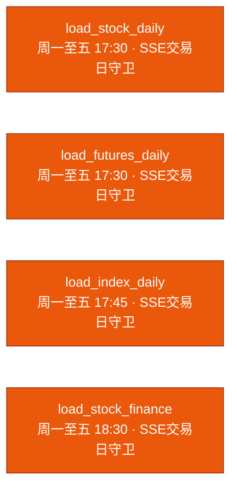

# 调度任务清单与依赖关系

本文档由调度器测试准备阶段生成，展示 14 个调度任务的属性、DAG 依赖与执行条件。
任务定义源码：[scheduler/task_config.py](../scheduler/task_config.py)。

## 一、月链 DAG（两条独立链，按数据发布窗口逐日探测）

数据发布节奏（业务事实）：

- **车型月销量（style）**：车主之家每月 **12~15 号**发布上月数据
- **城市车型月销量（city）**：车主之家每月 **20~25 号**发布上月数据

因此月链拆为两条，cron 只在窗口内每日探测一次，crawl 任务通过本地 CSV/ODS 行数
判断上月数据是否到位，未到位抛 `SkipTask`，次日继续；到位后由事件驱动整条链。

### 1. Style 链（车型月销量，每月 12~15 号 03:00 探测）

- 根任务 `crawl_16888_style_monthly` 写入 `ods_sales_monthly_model`，其余 6 个任务
  由上游成功后事件驱动。
- `run_dwd_clean` 是唯一扇出节点，`update_lifecycle` 与 `run_dws_agg` 并行执行。

### 2. City 链（城市车型月销量，每月 20~25 号 03:30 探测）

- 根任务 `crawl_16888_city_monthly` 写入 `ods_sales_monthly_model_city`。
- City 链不与 style 链共享下游；style 链通常在 12~15 号即跑完，
  `dim_model` 已就绪，city DWD 清洗关联车型维度时不会缺维。

### 3. 就绪探测逻辑

crawl 任务按 `business_key = last_month`（YYYY-MM）执行三段判断：

1. **前置去重**：查 ODS 表中目标月行数；style ≥400 / city ≥20000 行视为已到位，
   抛 `SkipTask`，窗口内后续每日直接跳过。
2. **抓取**：子进程调用对应爬虫 `--months latest --headless --resume`，
   爬虫自身探测"站点最新有数据的月份"（city 版已对齐 style 的探测逻辑）。
3. **后置校验**：检查本地 `data/<prefix>_<YYYY-MM>.csv` 目标月行数；
   未达阈值说明站点仍发布上上月数据（目标月尚未发布），抛 `SkipTask`，
   次日窗口再探。

阈值定义见 [crawl_16888_job.py](../scheduler/jobs/crawl_16888_job.py)
中 `_MIN_ROWS_STYLE = 400`、`_MIN_ROWS_CITY = 20000`（约为月均行数的 80%，
防止抓到半截页面误判到位）。

## 二、日链 DAG（交易日独立 cron，互不依赖）

- 4 个任务均为独立 cron，`downstream=[]`，互不触发。
- 全部配置 `trade_calendar="SSE"`，非交易日写 `skipped` 不告警不重试。
- 已知隐患：`load_futures_daily` 是商品期货任务，却使用 A 股日历 SSE（非 SHFE），
  A 股休市而商品开市时会被误跳过。

## 三、任务明细

| # | task_id | 链 | callable | cron | 超时(分) | 重试(次/间隔分) | trade_calendar | business_key | 下游 |
|---|---------|----|----------|------|---------|----------------|----------------|--------------|------|
| 1 | crawl_16888_style_monthly | 月·style | crawl_16888_job:crawl_16888_style_monthly | day=12-15,hour=3,minute=0 | 180 | 3 / 30 | - | last_month | load_style_ods |
| 2 | load_style_ods | 月·style | load_ods_job:load_style_ods | 事件触发 | 60 | 2 / 15 | - | 继承上游 | build_sales_dimensions |
| 3 | build_sales_dimensions | 月·style | etl_jobs:build_dimensions | 事件触发 | 30 | 2 / 10 | - | 继承上游 | refresh_ads_zipper |
| 4 | refresh_ads_zipper | 月·style | etl_jobs:refresh_ads | 事件触发 | 15 | 2 / 5 | - | 继承上游 | run_dwd_clean |
| 5 | run_dwd_clean | 月·style | etl_jobs:run_dwd_clean | 事件触发 | 30 | 2 / 10 | - | 继承上游 | update_lifecycle, run_dws_agg |
| 6 | update_lifecycle | 月·style | etl_jobs:update_lifecycle | 事件触发 | 20 | 2 / 10 | - | 继承上游 | (终点) |
| 7 | run_dws_agg | 月·style | etl_jobs:run_dws_agg | 事件触发 | 20 | 2 / 10 | - | 继承上游 | (终点) |
| 8 | crawl_16888_city_monthly | 月·city | crawl_16888_job:crawl_16888_city_monthly | day=20-25,hour=3,minute=30 | 180 | 3 / 30 | - | last_month | load_city_ods |
| 9 | load_city_ods | 月·city | load_ods_job:load_city_ods | 事件触发 | 60 | 2 / 15 | - | 继承上游 | run_dwd_city_clean |
| 10 | run_dwd_city_clean | 月·city | etl_jobs:run_dwd_city_clean | 事件触发 | 30 | 2 / 10 | - | 继承上游 | (终点) |
| 11 | load_stock_daily | 日 | load_stock_ods_job:load_stock_daily | mon-fri 17:30 | 60 | 2 / 10 | SSE | today | (无) |
| 12 | load_futures_daily | 日 | load_futures_ods_job:load_futures_main_daily | mon-fri 17:30 | 30 | 2 / 10 | SSE | today | (无) |
| 13 | load_index_daily | 日 | load_index_ods_job:load_ths_index_daily | mon-fri 17:45 | 30 | 2 / 10 | SSE | today | (无) |
| 14 | load_stock_finance | 日 | load_stock_ods_job:load_stock_finance | mon-fri 18:30 | 90 | 1 / 30 | SSE | today | (无) |

> 重试 N 次 = 失败后重试次数（不含首次），总执行次数 N+1。
> cron 任务共 6 个（月链 style 1 + 月链 city 1 + 日链 4），事件触发任务 8 个（style 6 + city 2）。

## 四、两个 ODS 表与下游的对应关系

| ODS 表 | 来源爬虫 | 写入任务 | 下游 DWD | 触发的 ETL 链 |
|--------|---------|---------|---------|---------------|
| `ods_sales_monthly_model` | crawl_style.py | load_style_ods | `dwd_sales_monthly_model` | build_dimensions → refresh_ads → dwd_clean → (lifecycle, dws_agg) |
| `ods_sales_monthly_model_city` | crawl_city.py | load_city_ods | `dwd_sales_monthly_model_city` | run_dwd_city_clean |

关键事实：

- **两条链写入不同 ODS 表，互不触发对方下游。**
- **入库按目标月增量**：`load_style_ods` / `load_city_ods` 按 `business_key`
  只加载 `<prefix>_<YYYY-MM>.csv`，不再每月重放 data 目录全部历史 CSV。
- **city 链依赖 style 链产出的 dim_model**：city DWD 清洗通过
  `LEFT JOIN dim_model` 补车型维度。`run_dwd_city_clean` 执行前会统计目标月
  ODS city 未匹配 dim_model 的行数，超过 500 行抛 `SkipTask`（style 链可能
  尚未跑完），次日 city cron 再试；阈值内容忍并继续。同时 clean 阶段会检测
  dim_model 是否存在同名车型（city ODS 无厂商字段无法 oem 消歧），存在则阻断。

## 五、执行条件与守卫（7 类）

1. **交易日守卫**：日链 4 个任务执行前查询 `dim_trade_calendar`（SSE），非交易日
   写 `skipped` 返回；日历表无当日记录时告警并按交易日处理（避免阻塞）。
2. **上游成功依赖**：月链 8 个事件触发任务由 `_trigger_downstream` 在上游成功后
   以 `dependency` 触发，按 `parent_run_id` 幂等去重。
3. **数据就绪守卫**（月链 crawl）：
   - 前置：ODS 已有目标月足够行数（style ≥400 / city ≥20000）→ `SkipTask`，窗口内不重抓。
   - 后置：本地 CSV 目标月行数不足 → `SkipTask`，判定站点尚未发布，次日再探。
4. **跨链 dim_model 就绪守卫**（city DWD）：`run_dwd_city_clean` 执行前统计目标
   月 ODS city 未匹配 dim_model 的行数，超 500 行抛 `SkipTask` 次日重试；清洗
   内部再检测 dim_model 同名车型与未匹配阈值，双重防护。
5. **存储过程内预检**：
   - `sp_etl_build_sales_dimensions`：`dim_brand` 必须存在 `brand_code='OTHER'`；
     存在未命中 `dim_oem` 的主机厂时 SIGNAL 45000 阻断。
   - `sp_etl_clean_sales_dwd`：未匹配 `dim_model` 行数 >100 阻断；>0 且 ≤100
     写入后发 01000 note 提醒不回滚。
   - city DWD 清洗：dim_model 存在同名车型直接阻断；未匹配行数 >500 阻断。
   - `sp_etl_update_lifecycle`：DWD 无数据时直接返回 0 行不报错。
6. **启动恢复（run_recovery）**：runner 启动时将残留 `running/retrying` 清扫为
   `killed`，UPSERT 心跳行，扫描近 24 小时 success 但下游缺口自动补触发。
7. **失败重试**：全部 14 个任务均配置，重试通过 APScheduler date 触发器在间隔
   分钟后调度，耗尽则 `failed` 并 ERROR 告警。`SkipTask` 主动跳过重试也不告警。

## 六、执行时序

- **月度 style**：每月 12~15 号每日 03:00 探测，首次到位即跑完整条 style 链
  （耗时取决于采集，最长 180 分 + 链上各任务超时之和），到位后次日 cron 因
  前置去重自动 SkipTask。
- **月度 city**：每月 20~25 号每日 03:30 探测，首次到位即跑 city 链；通常在
  style 链跑完约一周后执行，`dim_model` 已就绪。
- **交易日**：17:30 股票/期货并行 → 17:45 指数 → 18:30 财报增量。
